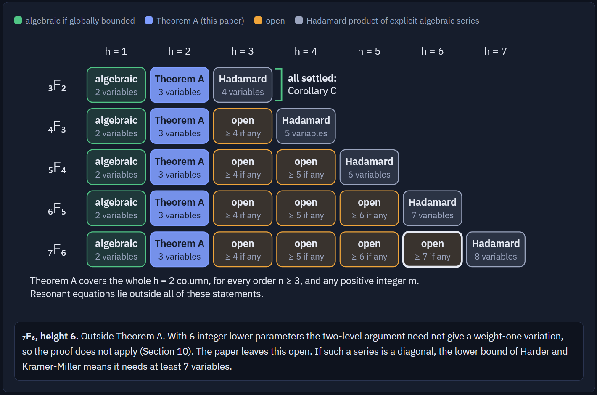
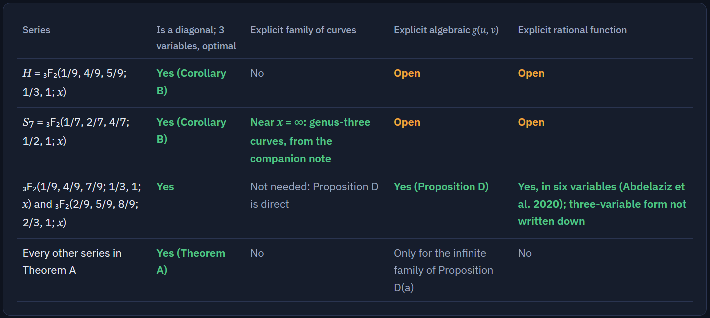

# Graphics

Explanatory figures for the paper (version 1.9.1). They summarise its statements and are not part of the proof.

## Order, height and how many variables a diagonal needs

Rows are the order of $`{}_nF_{n-1}`$ (from $`{}_3F_2`$ to $`{}_7F_6`$). Columns are the height $`h`$, the number of integer lower parameters when $`n!`$ is counted as one.

- **Height 1:** a globally bounded series is algebraic, so it is a diagonal in 2 variables.
- **Height 2:** Theorem A, for every order $`n \ge 3`$ and any positive integer lower parameter $`m`$. The diagonal needs 3 variables, which is optimal.
- **Maximal height $`h = n`$:** an explicit Hadamard product of $`n`$ algebraic series, so $`n+1`$ variables, which is optimal (Remark 9.6).
- **Intermediate heights:** open. If such a series is a diagonal, the lower bound of Harder and Kramer-Miller means it needs at least $`h+1`$ variables.

For $`{}_3F_2`$ every height is settled (Corollary C). Resonant equations lie outside all of these statements.

## What is and isn't established

For each series the table shows whether it is proved to be a diagonal, and whether an explicit family of curves, an explicit algebraic series $`g(u,v)`$, or an explicit rational function is known. Theorem A proves that the diagonals exist without constructing them. For Christol's series $`H`$ and for $`S_7`$, no explicit algebraic or rational representation is known.
